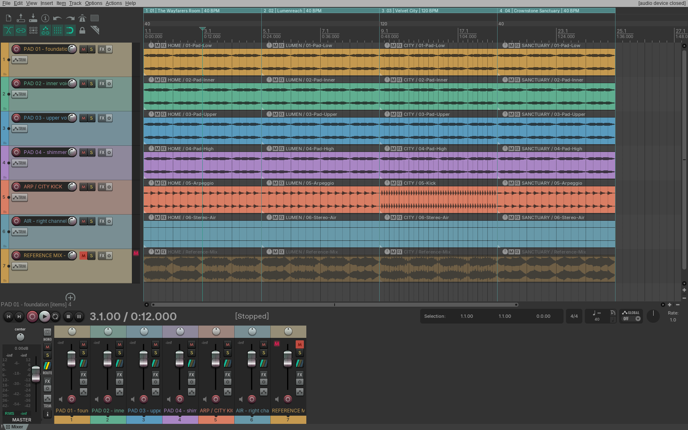

# LAST SAVE soundtrack production

Editable export of the **regular main game's existing four 24-second music sketches**, separated directly from `tools/make-audio.py`. This branch adds media and authoring tools; it does not change the main game or its deployment.

[Download the complete production pack](https://github.com/hamzahelhafdaoui/last-save-demo-3d-v0.1/releases/tag/soundtrack-production-2026-10-23)



The package contains 24 aligned stereo stems (48 kHz / 24-bit), four reference mixes and unchanged game OGGs, 28 MIDI files, five native REAPER sessions, a 96-second MP3 preview, the original synthesis code, editable sound/note recipe, validation reports, and the screenshot. The source music was synthesized at 22.05 kHz; resampling does not add fidelity.

FL Studio users should extract the ZIP, choose one cue, set **40 BPM** (home/lumen/sanctuary) or **120 BPM** (city), then drag that cue's six WAV stems to separate Playlist tracks at bar 1 with time stretching disabled. Import MIDI to edit pitches with your own instruments. There is no native `.flp`: the native projects are REAPER `.rpp`, while WAV and MIDI are portable. See [full instructions](README.txt).

## Rebuild

Requires Python 3.11+ and FFmpeg:

```sh
python -m pip install -r soundtrack/authoring/requirements.txt
python soundtrack/authoring/export.py --zip soundtrack/artifacts/LAST-SAVE-Soundtrack-Production.zip
python soundtrack/authoring/verify-package.py soundtrack/artifacts/LAST-SAVE-Soundtrack-Production.zip
```

The export reads the unchanged original game's `tools/make-audio.py` and `public/audio/*.ogg`. Run it from this repository. Generated audio lives under `soundtrack/generated/` and is not mixed into the game's shipping assets.

## Verified

The layer exporter compares its output against an independent scalar implementation of the actual original synthesis at more than 8,000 source positions per cue, including chord boundaries. Error is below `3e-13` before 24-bit quantisation. The exported stems null against the exported reference within `3.58e-7` (below −128 dBFS). All 28 WAVs have the same 24-second length, correct stereo/sample format, and no clipping; all MIDI tracks have balanced note events and a correct tempo/duration.

REAPER 7.82 actually opened all five projects: zero missing sources, correct cue regions, 7 tracks each, muted reference, unity faders, correct item positions and tempo grid. Its full 96-second offline 24-bit render matched the sum of exported stems **exactly**. `verification/` records those checks and the SHA256 of every tested WAV; the package verifier checks the downloadable WAVs against this evidence. Interactive monitoring on an audio hardware device and FL Studio itself were not tested in this cloud environment.

The screenshot is an unretouched capture of the actual REAPER session, with vertical waveform display magnification for readability. It is not a generated or simulated DAW interface.

The score remains a set of provisional synthesized loops; this export does not turn it into a finished orchestral score. Gameplay effects and dynamic scene crossfades are outside this music pack.

## Preservation

Authoring code, documentation, screenshot, verification evidence and a lossless split copy of the exact ZIP are committed on `media/soundtrack-production`. `soundtrack/upload/` is a transfer archive because direct release asset uploads from this environment are unavailable. The publication workflow reassembles the exact bytes, verifies them, and uploads permanent release downloads. It does not rebuild or deploy the game.

The original game remains at main commit `c193b5d36e360522a804fe0130ff7be3ed0a03f3`; https://last-save-demo-3d.vercel.app/ remains the production game URL.
